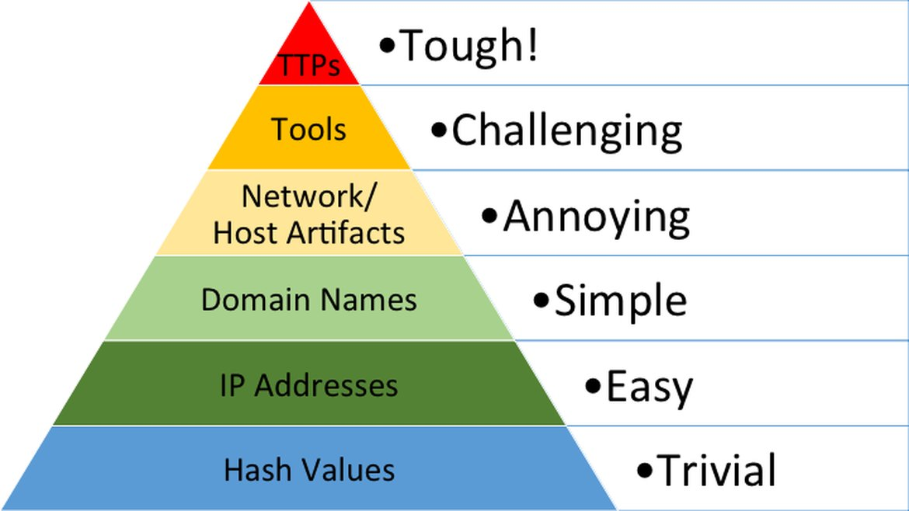

% Detection as Code

# whoami?

<br>

::: incremental

 - Chandler
	 - aka Throwaway2155
 - General Tinkerer
 - Flag Capturer
 - Security Analyst

:::

<br>
<br>

# whatis?

## [ Detection as Code ]{.no_title_overflow}

<br>
<br>

::: incremental
 - Version Control (git, mercurial, subversion, etc)
 - Automated Deployment
 - Automated Verification
 - Automated Regression Testing
:::

<br>
<br>
<br>

::: notes
Detection as Code is a process where you incorporate some software development techniques into the detection engineering process.

It allows you to version control your detections, allowing you to track what changes were made and by whom.
It also allows you to setup automation pipelines to lint, test, and deploy detections to your siem(s).

Before moving to the next slide I ask how many people are familiar with Detection Engineering.
:::

## [ Detection Engineering ]{.no_title_overflow}

<br>

::: incremental
Waaay more than just writing detections:

 - determining necessity of logsources
 - ingesting logsources into the SIEM
 - tuning SIEM (overlap with SIEM engineer)
 - measuring detection efficacy
 - tuning detections
:::

<br>
<br>
<br>
<br>

## [ Detections ]{.no_title_overflow}

<br>
<br>

::: incremental
 - binary signatures
 - behavioral signatures
 - anomalies 
:::

::: notes
When talking about writing detections there are 3 main things we're talking about: binary signatures, behavioral signatures, and anomalies.

Binary signatures look for specific patterns in binaries themself or in the memory they allocate.
The standard format for this would be yara.

Behavioral signatures look for what happens on a system: logins, thread creation, handle grabbing, etc.
There is no standard format for this.
(* kinda we'll get back to this.)

Anomalies are anything that doesn't normally happen. This is important but would require a whole other talk to dive into.

The following examples of detections aren't super great, they rely on things being named a specific way.

:::

<br>
<br>
<br>
<br>

### [ Binary Signatures ]{.no_title_overflow}

<br>
<br>

```yara
rule Windows_Hacktool_Mimikatz_1388212a {
    meta:
        author = "Elastic Security"
        id = "1388212a-2146-4565-b93d-4555a110364f"
        fingerprint = "dbbdc492c07e3b95d677044751ee4365ec39244e300db9047ac224029dfe6ab7"
        creation_date = "2021-04-13"
        last_modified = "2021-08-23"
        threat_name = "Windows.Hacktool.Mimikatz"
        reference_sample = "66b4a0681cae02c302a9b6f1d611ac2df8c519d6024abdb506b4b166b93f636a"
        severity = 100
        arch_context = "x86"
        scan_context = "file, memory"
        license = "Elastic License v2"
        os = "windows"
    strings:
        $a1 = "   Password: %s" wide fullword
        $a2 = "  * Session Key   : 0x%08x - %s" wide fullword
        $a3 = "   * Injecting ticket : " wide fullword
        $a4 = " ## / \\ ##  /*** Benjamin DELPY `gentilkiwi` ( benjamin@gentilkiwi.com )" wide fullword
        $a5 = "Remove mimikatz driver (mimidrv)" wide fullword
        $a6 = "mimikatz(commandline) # %s" wide fullword
        $a7 = "  Password: %s" wide fullword
        $a8 = " - SCardControl(FEATURE_CCID_ESC_COMMAND)" wide fullword
        $a9 = " * to 0 will take all 'cmd' and 'mimikatz' process" wide fullword
        $a10 = "** Pass The Ticket **" wide fullword
        $a11 = "-> Ticket : %s" wide fullword
        $a12 = "Busylight Lync model (with bootloader)" wide fullword
        $a13 = "mimikatz.log" wide fullword
        $a14 = "Log mimikatz input/output to file" wide fullword
        $a15 = "ERROR kuhl_m_dpapi_masterkey ; kull_m_dpapi_unprotect_domainkey_with_key" wide fullword
        $a16 = "ERROR kuhl_m_lsadump_dcshadow ; unable to start the server: %08x" wide fullword
        $a17 = "ERROR kuhl_m_sekurlsa_pth ; GetTokenInformation (0x%08x)" wide fullword
        $a18 = "ERROR mimikatz_doLocal ; \"%s\" module not found !" wide fullword
        $a19 = "Install and/or start mimikatz driver (mimidrv)" wide fullword
        $a20 = "Target: %hhu (0x%02x - %s)" wide fullword
        $a21 = "mimikatz Ho, hey! I'm a DC :)" wide fullword
        $a22 = "mimikatz service (mimikatzsvc)" wide fullword
        $a23 = "[masterkey] with DPAPI_SYSTEM (machine, then user): " wide fullword
        $a24 = "$http://blog.gentilkiwi.com/mimikatz 0" ascii fullword
        $a25 = " * Username : %wZ" wide fullword
    condition:
        3 of ($a*)
}
```

### [ Binary Signatures (cont.) ]{.no_title_overflow}

<br>
<br>

```yara
rule Windows_Hacktool_Mimikatz_674fd079 {
    meta:
        author = "Elastic Security"
        id = "674fd079-f7fe-4d89-87e7-ac11aa21c9ed"
        fingerprint = "b8f71996180e5f03c10e39eb36b2084ecaff78d7af34bd3d0d75225d2cfad765"
        creation_date = "2021-04-14"
        last_modified = "2021-08-23"
        description = "Detection for default mimikatz memssp module"
        threat_name = "Windows.Hacktool.Mimikatz"
        reference_sample = "66b4a0681cae02c302a9b6f1d611ac2df8c519d6024abdb506b4b166b93f636a"
        severity = 99
        arch_context = "x86"
        scan_context = "file, memory"
        license = "Elastic License v2"
        os = "windows"
    strings:
        $a1 = { 44 30 00 38 00 }
        $a2 = { 48 78 00 3A 00 }
        $a3 = { 4C 25 00 30 00 }
        $a4 = { 50 38 00 78 00 }
        $a5 = { 54 5D 00 20 00 }
        $a6 = { 58 25 00 77 00 }
        $a7 = { 5C 5A 00 5C 00 }
        $a8 = { 60 25 00 77 00 }
        $a9 = { 64 5A 00 09 00 }
        $a10 = { 6C 5A 00 0A 00 }
        $a11 = { 68 25 00 77 00 }
        $a12 = { 68 25 00 77 00 }
        $a13 = { 6C 5A 00 0A 00 }
        $b1 = { 6D 69 6D 69 C7 84 24 8C 00 00 00 6C 73 61 2E C7 84 24 90 00 00 00 6C 6F 67 }
    condition:
        all of ($a*) or $b1
}
```
<br>
<br>
<br>
<br>

### [ Behavioral Signatures ]{.no_title_overflow}

<br>
<br>
<br>

```eql
file where host.os.type == "windows" and file.name : "mimilsa.log" and process.name : "lsass.exe"
```

<br>
<br>
<br>
<br>

### [ Behavioral Signatures (cont.) ]{.no_title_overflow}

<br>
<br>

```splunk
| tstats `security_content_summariesonly` count min(_time) as firstTime max(_time)
  as lastTime from datamodel=Endpoint.Processes where (Processes.process_name=mimikatz.exe
  OR Processes.original_file_name=mimikatz.exe) by Processes.action Processes.dest
  Processes.original_file_name Processes.parent_process Processes.parent_process_exec
  Processes.parent_process_guid Processes.parent_process_id Processes.parent_process_name
  Processes.parent_process_path Processes.process Processes.process_exec Processes.process_guid
  Processes.process_hash Processes.process_id Processes.process_integrity_level Processes.process_name
  Processes.process_path Processes.user Processes.user_id Processes.vendor_product
  | `drop_dm_object_name(Processes)` | `security_content_ctime(firstTime)` | `security_content_ctime(lastTime)`
  | `windows_mimikatz_binary_execution_filter`
```

<br>

### [ Behavioral Signatures (cont.) (cont.) ]{.no_title_overflow}

<br>

```sigma
    selection_tools_name:
        CommandLine|contains:
            - 'DumpCreds'
            - 'mimikatz'
    selection_function_names: # To cover functions from modules that are not in module_names
        CommandLine|contains:
            - '::aadcookie' # misc module
            - '::detours' # misc module
            - '::memssp' # misc module
            - '::mflt' # misc module
            - '::ncroutemon' # misc module
            - '::ngcsign' # misc module
            - '::printnightmare' # misc module
            - '::skeleton' # misc module
            - '::preshutdown'  # service module
            - '::mstsc'  # ts module
            - '::multirdp'  # ts module
    selection_module_names:
        CommandLine|contains:
            - 'rpc::'
            - 'token::'
            - 'crypto::'
            - 'dpapi::'
            - 'sekurlsa::'
            - 'kerberos::'
            - 'lsadump::'
            - 'privilege::'
            - 'process::'
            - 'vault::'
    condition: 1 of selection_*
```

<br>


## [ Good Detections? ]{.no_title_overflow}



::: notes
Your detections should be targeting the top of the pyramid.

Tools and TTPs are what you mostly want to be focusing on.

The previous detections are for tools.

Detecting TTPs is much more difficult but well worth the effort.
:::


## Demo: Manual Detection

::: notes
This is where I show how you manually add a detection in kibana.

"There has to be a better way" and all that

detection to copy:

`(process.command_line:(*DumpCreds* OR *mimikatz*)) OR (process.command_line:(*\:\:aadcookie* OR *\:\:detours* OR *\:\:memssp* OR *\:\:mflt* OR *\:\:ncroutemon* OR *\:\:ngcsign* OR *\:\:printnightmare* OR *\:\:skeleton* OR *\:\:preshutdown* OR *\:\:mstsc* OR *\:\:multirdp*)) OR (process.command_line:(*rpc\:\:* OR *token\:\:* OR *crypto\:\:* OR *dpapi\:\:* OR *sekurlsa\:\:* OR *kerberos\:\:* OR *lsadump\:\:* OR *privilege\:\:* OR *process\:\:* OR *vault\:\:*))`
:::

## [ Consumable Format ]{.no_title_overflow}

<br>

::: incremental
 - Holds detection logic
 - Holds metadata
     - info on detection
     - triage guide
     - possible false positives
     - known false positives
     - mitre tags
 - Easily Parsed
:::

<br>
<br>
<br>

### Elastic Toml

<br>

```
[metadata]
creation_date = "2020/08/31"
integration = ["endpoint", "windows", "sentinel_one_cloud_funnel", "m365_defender", "crowdstrike"]
maturity = "production"
updated_date = "2025/08/26"

[rule]
author = ["Elastic"]
description = "Identifies the password log file from the default Mimikatz memssp module."
from = "now-9m"
index = [
    "winlogbeat-*",
    "logs-endpoint.events.file-*",
    "logs-windows.sysmon_operational-*",
    "endgame-*",
    "logs-sentinel_one_cloud_funnel.*",
    "logs-m365_defender.event-*",
    "logs-crowdstrike.fdr*",
]
language = "eql"
license = "Elastic License v2"
name = "Mimikatz Memssp Log File Detected"
note = """## Triage and analysis

### Investigating Mimikatz Memssp Log File Detected

[Mimikatz](https://github.com/gentilkiwi/mimikatz) is an open-source tool used to collect, decrypt, and/or use cached credentials. This tool is commonly abused by adversaries during the post-compromise stage where adversaries have gained an initial foothold on an endpoint and are looking to elevate privileges and seek out additional authentication objects such as tokens/hashes/credentials that can then be used to laterally move and pivot across a network.

This rule looks for the creation of a file named `mimilsa.log`, which is generated when using the Mimikatz misc::memssp module, which injects a malicious Windows SSP to collect locally authenticated credentials, which includes the computer account password, running service credentials, and any accounts that logon.

#### Possible investigation steps

- Investigate the script execution chain (parent process tree) for unknown processes. Examine their executable files for prevalence, whether they are located in expected locations, and if they are signed with valid digital signatures.
- Investigate other alerts associated with the user/host during the past 48 hours.
- Investigate potentially compromised accounts. Analysts can do this by searching for login events (e.g., 4624) to the target host.
- Retrieve and inspect the log file contents.
- Search for DLL files created in the same location as the log file, and retrieve unsigned DLLs.
  - Use the PowerShell Get-FileHash cmdlet to get the SHA-256 hash value of these files.
    - Search for the existence of these files in resources like VirusTotal, Hybrid-Analysis, CISCO Talos, Any.run, etc.
  - Identify the process that created the DLL using file creation events.

### False positive analysis

- This file name `mimilsa.log` should not legitimately be created.

### Related rules

- Mimikatz Powershell Module Activity - ac96ceb8-4399-4191-af1d-4feeac1f1f46

### Response and remediation

- Initiate the incident response process based on the outcome of the triage.
- Isolate the involved hosts to prevent further post-compromise behavior.
- If the host is a Domain Controller (DC):
  - Activate your incident response plan for total Active Directory compromise.
  - Review the privileges assigned to users that can access the DCs to ensure that the least privilege principle is being followed and reduce the attack surface.
- Investigate credential exposure on systems compromised or used by the attacker to ensure all compromised accounts are identified. Reset passwords for these accounts and other potentially compromised credentials, such as email, business systems, and web services.
- Reboot the host to remove the injected SSP from memory.
- Reimage the host operating system or restore compromised files to clean versions.
- Run a full antimalware scan. This may reveal additional artifacts left in the system, persistence mechanisms, and malware components.
- Determine the initial vector abused by the attacker and take action to prevent reinfection through the same vector.
- Using the incident response data, update logging and audit policies to improve the mean time to detect (MTTD) and the mean time to respond (MTTR).
"""
references = ["https://www.elastic.co/security-labs/detect-credential-access"]
risk_score = 73
rule_id = "ebb200e8-adf0-43f8-a0bb-4ee5b5d852c6"
setup = """## Setup

If enabling an EQL rule on a non-elastic-agent index (such as beats) for versions <8.2,
events will not define `event.ingested` and default fallback for EQL rules was not added until version 8.2.
Hence for this rule to work effectively, users will need to add a custom ingest pipeline to populate
`event.ingested` to @timestamp.
For more details on adding a custom ingest pipeline refer - https://www.elastic.co/guide/en/fleet/current/data-streams-pipeline-tutorial.html
"""
severity = "high"
tags = [
    "Domain: Endpoint",
    "OS: Windows",
    "Use Case: Threat Detection",
    "Tactic: Credential Access",
    "Resources: Investigation Guide",
    "Data Source: Elastic Endgame",
    "Data Source: Elastic Defend",
    "Data Source: Sysmon",
    "Data Source: SentinelOne",
    "Data Source: Microsoft Defender for Endpoint",
    "Data Source: Crowdstrike",
]
timestamp_override = "event.ingested"
type = "eql"

query = '''
file where host.os.type == "windows" and file.name : "mimilsa.log" and process.name : "lsass.exe"
'''


[[rule.threat]]
framework = "MITRE ATT&CK"
[[rule.threat.technique]]
id = "T1003"
name = "OS Credential Dumping"
reference = "https://attack.mitre.org/techniques/T1003/"


[rule.threat.tactic]
id = "TA0006"
name = "Credential Access"
reference = "https://attack.mitre.org/tactics/TA0006/"
```

<br>
<br>
<br>

### Splunk Yaml

<br>

```
name: Windows Mimikatz Binary Execution
id: a9e0d6d3-9676-4e26-994d-4e0406bb4467
version: 10
date: '2025-07-29'
author: Michael Haag, Splunk
status: production
type: TTP
description: The following analytic identifies the execution of the native mimikatz.exe
  binary on Windows systems, including instances where the binary is renamed. It leverages
  data from Endpoint Detection and Response (EDR) agents, focusing on process names
  and original file names. This activity is significant because Mimikatz is a widely
  used tool for extracting authentication credentials, posing a severe security risk.
  If confirmed malicious, this activity could allow attackers to obtain sensitive
  credentials, escalate privileges, and move laterally within the network, leading
  to potential data breaches and system compromise.
data_source:
- Sysmon EventID 1
- Windows Event Log Security 4688
- CrowdStrike ProcessRollup2
search: '| tstats `security_content_summariesonly` count min(_time) as firstTime max(_time)
  as lastTime from datamodel=Endpoint.Processes where (Processes.process_name=mimikatz.exe
  OR Processes.original_file_name=mimikatz.exe) by Processes.action Processes.dest
  Processes.original_file_name Processes.parent_process Processes.parent_process_exec
  Processes.parent_process_guid Processes.parent_process_id Processes.parent_process_name
  Processes.parent_process_path Processes.process Processes.process_exec Processes.process_guid
  Processes.process_hash Processes.process_id Processes.process_integrity_level Processes.process_name
  Processes.process_path Processes.user Processes.user_id Processes.vendor_product
  | `drop_dm_object_name(Processes)` | `security_content_ctime(firstTime)` | `security_content_ctime(lastTime)`
  | `windows_mimikatz_binary_execution_filter`'
how_to_implement: The detection is based on data that originates from Endpoint Detection
  and Response (EDR) agents. These agents are designed to provide security-related
  telemetry from the endpoints where the agent is installed. To implement this search,
  you must ingest logs that contain the process GUID, process name, and parent process.
  Additionally, you must ingest complete command-line executions. These logs must
  be processed using the appropriate Splunk Technology Add-ons that are specific to
  the EDR product. The logs must also be mapped to the `Processes` node of the `Endpoint`
  data model. Use the Splunk Common Information Model (CIM) to normalize the field
  names and speed up the data modeling process.
known_false_positives: False positives should be limited as this is directly looking
  for Mimikatz, the credential dumping utility.
references:
- https://www.cisa.gov/uscert/sites/default/files/publications/aa22-320a_joint_csa_iranian_government-sponsored_apt_actors_compromise_federal%20network_deploy_crypto%20miner_credential_harvester.pdf
- https://www.varonis.com/blog/what-is-mimikatz
- https://media.defense.gov/2023/May/24/2003229517/-1/-1/0/CSA_Living_off_the_Land.PDF
drilldown_searches:
- name: View the detection results for - "$user$" and "$dest$"
  search: '%original_detection_search% | search  user = "$user$" dest = "$dest$"'
  earliest_offset: $info_min_time$
  latest_offset: $info_max_time$
- name: View risk events for the last 7 days for - "$user$" and "$dest$"
  search: '| from datamodel Risk.All_Risk | search normalized_risk_object IN ("$user$",
    "$dest$") starthoursago=168  | stats count min(_time) as firstTime max(_time)
    as lastTime values(search_name) as "Search Name" values(risk_message) as "Risk
    Message" values(analyticstories) as "Analytic Stories" values(annotations._all)
    as "Annotations" values(annotations.mitre_attack.mitre_tactic) as "ATT&CK Tactics"
    by normalized_risk_object | `security_content_ctime(firstTime)` | `security_content_ctime(lastTime)`'
  earliest_offset: $info_min_time$
  latest_offset: $info_max_time$
rba:
  message: An instance of $parent_process_name$ spawning $process_name$ was identified
    on endpoint $dest$ by user $user$ attempting dump credentials.
  risk_objects:
  - field: user
    type: user
    score: 100
  - field: dest
    type: system
    score: 100
  threat_objects:
  - field: parent_process_name
    type: parent_process_name
  - field: process_name
    type: process_name
tags:
  analytic_story:
  - Sandworm Tools
  - Volt Typhoon
  - Flax Typhoon
  - CISA AA22-320A
  - CISA AA23-347A
  - Compromised Windows Host
  - Credential Dumping
  - Scattered Spider
  asset_type: Endpoint
  mitre_attack_id:
  - T1003
  product:
  - Splunk Enterprise
  - Splunk Enterprise Security
  - Splunk Cloud
  security_domain: endpoint
tests:
- name: True Positive Test
  attack_data:
  - data: https://media.githubusercontent.com/media/splunk/attack_data/master/datasets/attack_techniques/T1003/credential_extraction/mimikatzwindows-sysmon.log
    source: XmlWinEventLog:Microsoft-Windows-Sysmon/Operational
    sourcetype: XmlWinEventLog
```

<br>
<br>
<br>

## Sigma

<br>
<br>

::: incremental
 - Generic Behavioral Signature Format for SIEMs
 - Useful for:
     - Sharing detections
     - Multiple SIEMs (eq: Sentinal + Chronical)
     - No SIEM (GET-WinEvent | SQL)
     - Transitioning between SIEMs
     - Keeping everything in a unified format
:::

<br>
<br>
<br>
<br>

## Sigma Example

<br>

::: citation
```
title: HackTool - Mimikatz Execution
id: a642964e-bead-4bed-8910-1bb4d63e3b4d
status: test
description: Detection well-known mimikatz command line arguments
references:
    - https://www.slideshare.net/heirhabarov/hunting-for-credentials-dumping-in-windows-environment
    - https://tools.thehacker.recipes/mimikatz/modules
author: Teymur Kheirkhabarov, oscd.community, David ANDRE (additional keywords), Tim Shelton
date: 2019-10-22
modified: 2023-02-21
tags:
    - attack.credential-access
    - attack.t1003.001
    - attack.t1003.002
    - attack.t1003.004
    - attack.t1003.005
    - attack.t1003.006
logsource:
    category: process_creation
    product: windows
detection:
    selection_tools_name:
        CommandLine|contains:
            - 'DumpCreds'
            - 'mimikatz'
    selection_function_names:    # To cover functions from modules that are not in module_names
        CommandLine|contains:
            - '::aadcookie'      # misc module
            - '::detours'        # misc module
            - '::memssp'         # misc module
            - '::mflt'           # misc module
            - '::ncroutemon'     # misc module
            - '::ngcsign'        # misc module
            - '::printnightmare' # misc module
            - '::skeleton'       # misc module
            - '::preshutdown'    # service module
            - '::mstsc'          # ts module
            - '::multirdp'       # ts module
    selection_module_names:
        CommandLine|contains:
            - 'rpc::'
            - 'token::'
            - 'crypto::'
            - 'dpapi::'
            - 'sekurlsa::'
            - 'kerberos::'
            - 'lsadump::'
            - 'privilege::'
            - 'process::'
            - 'vault::'
    condition: 1 of selection_*
falsepositives:
    - Unlikely
level: high
```
:::

<br>
<br>
<br>

::: notes

There are 3 main parts of a sigma rule:

 - Metadata
 - Logsource
 - Detection Logic

Most of the metadata tags are [self explanatory](https://github.com/SigmaHQ/sigma-specification/blob/main/specification/sigma-rules-specification.md) 
The related tag is not shown here, it allows you to show what rule this rule is derived from. It takes a rule id and a string with one of the following:

 - derived
 - obsolete
 - merged
 - renamed
 - similar

The status tag can have the following strings:

 - stable
 - test
 - experimental
 - deprecated
 - unsupported

The license tag uses the spxd id for it's string.

The Tags tag supports arbitrary and defined strings:

 - MITRE ATT&CK
 - MITRE D3fend
 - MITRE CAR
 - CVE
 - CWE

The level tag has the following options:
 
 - informational
 - low
 - medium
 - high
 - critical

Logsource tells the sigma backend which logs to look at. 
It has the following keys:

 - Category: Category of product (Ex. Webserver, firewall, EDR)
 - Product: The specific product (Ex. Windows, linux, cisco)
 - Service: Service within the product (Ex. Kerberos, Defender)
 - Definition: Comment that allows you to provide extra information such as "X needs to be turned on to receive thees logs"
:::

## [ Sigma Detection Logic ]{.no_title_overflow}

::: slightly_smaller_text
```yaml
detection:
    keywords:
        - 'rm *bash_history'
        - 'echo "" > *bash_history'
        - 'truncate -s0 *bash_history'
        - 'history -c'
        - 'history -w'
```
:::

::: slightly_smaller_text
```yaml
detection:
    selection:
        EventID:
            - 4728
            - 4729
            - 4730
```
:::

::: slightly_smaller_text
```yaml
detection:
    selection:
        EventID: 6416
        ClassName: 'DiskDrive'
```
:::

::: notes
There are 2 main keys in the detection key:

 - selection
 - condition

There are 2 selection methods:

 - keywords
 - fields

Keywords are checking the logsource for a specified string.
Fields are checking values in specific fields.

Also be aware of implicit `or` and `and` statements. 
Keyword selections are always `or`.
The first selection example is an `or` the second is an `and`.

Field selections are more efficient which is useful for something like sumologic where you're billed on searches.
:::

### [ Sigma Detection Logic (Conditions) ]{.no_title_overflow}

<br>
<br>

```yaml
detection:
    select_event_codes:
        event.code:
            - 4728
            - 4729
            - 4730
    filter_user:
        user.name: "d4s3"
    condition: select_event_codes and not filter_user
```

<br>
<br>

::: notes
With the condition tag you can create logic between selections and filters.
`select_event_codes` and `filter_user` are arbitrary strings

There are `not`, `and`, `or`, and brackets for conditionals.
There are also `1 of (search pattern)` and `all of (search pattern)`
:::

### [ Sigma Detection Logic (Modifiers) ]{.no_title_overflow}

<br>
<br>

```yaml
detection:
    selection:
        event.code|all:
            - 4728
            - 4729
            - 4730
```

```yaml
detection:
    selection:
        process.command_line|containes: "bash_history"
```

<br>
<br>

::: notes
There are 20 modifiers that can be found [here](https://sigmahq.io/docs/basics/modifiers.html).

The ones shown are `all` which changes an `or` statement to an `and` statement, and `contains` which allows you to fuzzy search for that string in the value.
`endswith` is similar to contains but only checks the end of the value.
:::

### Sigma Parts

<br>
<br>

::: incremental
 - Backends
 - Pipeline
:::

<br>
<br>
<br>
<br>

::: notes
Backends handle the conversion between the sigma yaml doc and the siem specified format.
Pipelines convert the fields and logsources to the siem specific fields.

Example commands:

 - `uvx --from sigma-cli sigma plugin list`
 - `uvx --from sigma-cli sigma plugin install elasticsearch`

 - `uvx --from sigma-cli --with pySigma-backend-elasticsearch sigma list targets `
 - `uvx --from sigma-cli --with pySigma-backend-elasticsearch sigma list pipelines lucene`
 - `uvx --from sigma-cli --with pySigma-backend-elasticsearch sigma list formats lucene`


 - `uvx --from sigma-cli --with pySigma-backend-elasticsearch sigma convert mimikatz_example.yml -t lucene --without-pipeline `
 - `uvx --from sigma-cli --with pySigma-backend-elasticsearch sigma convert mimikatz_example.yml -t lucene -p ecs_windows`
 - `uvx --from sigma-cli --with pySigma-backend-elasticsearch sigma convert mimikatz_example.yml -t lucene -p ecs_windows -f siem_rule_ndjson`
:::

## Demo: DaC

::: notes
This is where I show off the detection as code repo.
Go through my thought process on why I'm doing certian things.
Talk about our custom yaml tags and why they're important.
Complain about the lack of documentation for pySigma.
Maybe actually demo a detection if I can get the runners setup.
:::

# [ EOF ]{.no_title_overflow}

<br>

::: bigish_img

:::

